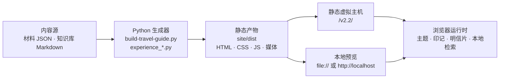

# 侨乡来信 · 江门

> 一封写给故乡的当代来信。沿楼的远望、街的回声、水的来信、味的归途，读一座侨乡，也写一张属于自己的明信片。

《侨乡来信 · 江门》是一件以侨乡文化为主题的 AIGC 多页面互动网站，配套一支 66 秒艺术短片。作品以原创书信体叙事串联开平碉楼、赤坎骑楼、西江水岸与新会陈皮，并把"观看"延伸为可参与的收藏、写信与旅行规划。

- **作品形态**：九页纯静态站点，可直接部署到任意静态虚拟主机，无需后端、数据库或账号体系。
- **内容规模**：4 章风物 · 20 项景点 · 14 项美食 · 6 条编辑路线 · 87 条本地问答。
- **技术形态**：HTML5 + CSS3 + 原生 JavaScript；Python 3 负责内容生成与静态验收。

> 本仓库为参赛提交版本。作品中的来信、短诗与明信片文案均为原创文学表达，不冒充历史侨批、档案原文或真实人物口述。

## 📖 目录

- [🌟 项目简介](#-项目简介)
- [🎯 功能特性](#-功能特性)
- [🧱 技术栈说明](#-技术栈说明)
- [🚀 安装与使用](#-安装与使用)
- [🔧 配置项说明](#-配置项说明)
- [📁 目录结构](#-目录结构)
- [📝 素材与事实边界](#-素材与事实边界)
- [🚧 已知限制](#-已知限制)
- [❓ 常见问题](#-常见问题)
- [📄 许可证](#-许可证)

## 🌟 项目简介

### 以"来信"组织一座城市

作品把江门拆成四条互为补充的线索：**楼的远望、街的回声、水的来信、味的归途**。四章分别对应开平碉楼、赤坎骑楼、西江水岸与新会陈皮，每章配一幅摄影风格的 AI 艺术影像、一篇注明资料来源的风物小记，以及一枚可收藏的文化印记（守望、相逢、相连、传承）。

叙事不追求百科式罗列，而是用一封写给故乡的信，把建筑、街巷、江河与手艺连接为同一种情感结构：远行与归来，日常与传承。

### 从阅读到参与

站点不止于浏览。观众可以收藏四枚印记，在集齐后进入收信结尾并为来信落款；可以在独立页面续写明信片，选择风景、填写收件人与寄语，保存为 PNG 或调用系统分享；也可以按时间与兴趣筛选路线，把想去与去过的地方记入旅行护照，生成纪念卡。

旅行指南面向首次到访江门的游客，提供七区市 20 项带实景配图的景点、14 项美食与 6 条半日至两日编辑路线，并明确区分官方资料、开放许可摄影与 AI 菜式示意。

### 作品信息

| 项目 | 内容 |
| --- | --- |
| 作品名称 | 侨乡来信 · 江门（A Letter from Jiangmen） |
| 创作形式 | AIGC 多页面互动网站 + 配套艺术短片 |
| 主题方向 | 美景、美食、乡情联结、手艺传承 |
| 创作展示名 | RTHLanStar |
| 创作者链接 | <https://github.com/RTHLanStar> |
| 本地版本 | 2026-10-19（九页站点，87 条问答） |
| 页面数量 | 9 |
| 短片规格 | 66 秒 / 1920×1080 / 24 fps / H.264 MP4 / 25 句中文字幕 |
| 部署要求 | 静态文件托管；无需 PHP、数据库或服务端运行时 |
| 许可协议 | CC BY-NC-ND 4.0（第三方素材除外，详见[许可证](#-许可证)） |

## 🎯 功能特性

| 模块 | 能力 | 状态 |
| --- | --- | --- |
| **四章风物叙事** | 图片滑动、章节标签、键盘切换、自动翻章，收藏后使用不同转场 | ✅ 已实现 |
| **今日江门来信** | 按访问日期生成当日短诗与来信，作为首页的情绪入口 | ✅ 已实现 |
| **配套短片** | 66 秒 1080P 影片、WebVTT 字幕轨、独立海报与站内播放 | ✅ 已实现 |
| **文化印记** | 四枚印记收藏、进度反馈、集齐后的收信结尾与落款引导 | ✅ 已实现 |
| **明信片工坊** | 选景、收件人、寄语编辑；草稿本地保存；PNG 导出与系统分享 | ✅ 已实现 |
| **旅行护照** | 七区市私人邮戳、想去/去过分别记录、1400×1740 PNG 纪念卡 | ✅ 已实现 |
| **旅行指南** | 20 项景点实景配图、14 项美食、地区筛选与景点美食双向互荐 | ✅ 已实现 |
| **路线向导** | 按半天/一天/两天与兴趣偏好筛选 6 条编辑路线，附接驳提示 | ✅ 已实现 |
| **站内问答** | 87 条预写问答的本地关键词与分类检索，附资料来源 | ✅ 已实现 |
| **作品导览** | 约 3 分钟的体验动线，串联短片、四章、明信片与旅行功能，可自由跳转 | ✅ 已实现 |
| **深浅色主题** | 跟随系统 / 浅色 / 深色三态切换，首帧不闪烁，跨页保持 | ✅ 已实现 |
| **打印适配** | 景点、美食、路线、站内问答四页可打印当前可见内容 | ✅ 已实现 |
| **无障碍与降级** | 跳至主内容、图片替代文本、键盘操作、减少动效、无 JavaScript 可读 | ✅ 已实现 |

### 页面一览

| 页面 | 文件 | 主要内容 |
| --- | --- | --- |
| 首页 | `index.html` | 两行标题打字机、四章风物轮播、文化印记、今日来信、短片与下一步入口 |
| 侨乡故事 | `stories.html` | 四章文化小记、资料背景与来源链接 |
| 我的来信 | `letters.html` | 旅行护照、七区市邮戳、旅行纪念卡与风景明信片 |
| 关于创作 | `about.html` | 创作思路、AI 使用说明、素材来源与作者署名 |
| 景点 | `travel.html` | 20 项景点、实景照片、七区市筛选、想去与去过记录 |
| 美食 | `food.html` | 14 项美食、地区筛选、图像说明与对应景点推荐 |
| 路线 | `routes.html` | 6 条编辑路线、时间与兴趣筛选、接驳提示与旅行建议 |
| 站内问答 | `faq.html` | 87 条本地问答检索、分类与来源；答案预写，不调用模型 |
| 作品导览 | `tour.html` | 约 3 分钟体验动线，各步骤可自由跳转 |

主导航为"首页、游江门、侨乡故事、我的来信、关于创作"五项，其中"游江门"下继续切换景点、美食与路线。

## 🧱 技术栈说明

| 层次 | 技术 | 说明 |
| --- | --- | --- |
| 结构 | HTML5 | 九页语义化静态文档，`lang="zh-CN"`，共享页头、页脚与导航结构 |
| 样式 | CSS3 自定义属性 | 无预处理器；以 `tokens.css` 为唯一取值来源，构建时按固定顺序拼接并生成内容哈希文件名 |
| 交互 | 原生 JavaScript（ES2015+） | 无前端框架、无运行时依赖；模块按页面以 `<script defer>` 引入 |
| 内容生成 | Python 3 | `build-travel-guide.py` 与 `experience_*.py` 生成旅行、问答、导览与分享元数据 |
| 静态验收 | Python 断言 | `verify-adopted-static.py` 校验页面结构、资源引用与主题注入幂等性 |
| 浏览器回归 | Node.js + Playwright（可选） | 16 个 `verify-*.cjs` 脚本覆盖布局、主题、问答、短片与存储行为 |
| 媒体 | HTML5 Video + WebVTT | 66 秒 H.264 MP4，独立字幕轨与海报图 |
| 图形 | Canvas 2D | 明信片与旅行纪念卡绘制，前端导出 PNG |
| 字体 | Noto Serif SC 子集 | WOFF2 子集化，SIL Open Font License 1.1 |
| 部署 | 静态托管 | 普通虚拟主机、对象存储或任意 HTTP 静态服务；支持 `/v2.2/` 子目录 |

### 架构与构建流程



构建分为两层：**生成期**由 Python 读取本地研究与知识库数据，写入页面片段、合并样式并刷新哈希引用；**运行期**只有静态文件与浏览器原生能力，不请求业务后端。

### 关键设计决策

1. **零框架交付。** 站点不引入前端框架或包管理器依赖，源码即产物，评审可直接阅读与运行，避免构建链失效导致作品不可用。
2. **生成器维护重复结构。** 景点、美食、路线与问答页面由 Python 生成，避免在多份 HTML 中手工维护重复卡片；手工修改会被下一次构建覆盖。
3. **设计令牌单一来源。** 颜色、字号、行高、字距与留白集中定义在 `tokens.css`；深色调色板只写一份覆盖，浅色与深色不会各自漂移。
4. **渐进增强。** 无 JavaScript 时保留可阅读内容与有效链接；浏览器存储不可用时明确提示"仅本页暂存"，不伪装为持久保存。
5. **事实与功能分离记录。** 资料核验日期与功能更新日期分开标注；旅行信息不承诺实时性，AI 图像不标注为实拍。

## 🚀 安装与使用

### 环境要求

| 场景 | 要求 |
| --- | --- |
| 浏览作品 | 近两年版本的 Chrome、Edge、Firefox 或 Safari；手机浏览器均可 |
| 本地静态服务 | 任意 HTTP 服务器；示例使用 Python 内置 `http.server` |
| 重新构建 | Python 3.8 及以上 |
| 浏览器回归（可选） | Node.js 18 及以上，以及本机 Playwright 与 Chromium |

### 方式一：直接打开（读者）

```bash
git clone https://github.com/RTHLanStar/XunMei-Jiangmen.git
cd XunMei-Jiangmen
```

双击 `site/dist/index.html` 即可阅读。请保留 `site/dist` 整个目录，九个页面与全部素材依靠相对路径连接；单独复制某一个 HTML 文件会导致样式、脚本与图片缺失。

> 以 `file://` 打开时，部分浏览器会限制本地存储或系统分享。需要完整功能时，请使用方式二。

### 方式二：本地静态服务器（推荐）

在仓库根目录执行：

```bash
python -m http.server 8080 --directory site/dist
```

浏览器访问 <http://localhost:8080>。HTTP 方式更接近线上环境，印记、草稿、想去与去过记录可以跨页面保持。

### 方式三：重新构建（开发者）

构建入口为 `制作源文件/build.py`，默认构建，可选追加静态验收或本地打包：

```bash
# 仅构建：生成页面、合并样式并刷新哈希引用
python 制作源文件/build.py

# 构建后运行静态验收（不启动浏览器）
python 制作源文件/build.py --verify

# 构建、静态验收并生成两份本地 ZIP
python 制作源文件/build.py --package
```

构建脚本要求仓库根部存在 `site/dist/index.html`，本仓库已满足该布局。构建不安装依赖、不上传服务器、不发布在线预览。

修改内容时的正确顺序是：先改 `材料/` 中的研究 JSON、`知识库/` 中的问答，或 `site/dist` 中的共享脚本与样式，再运行生成器；不要直接手改旅行页中由脚本生成的重复卡片。

### 部署到静态主机

1. 将 `site/dist/` 内的全部文件按原相对结构上传至目标目录（示例为 `/v2.2/`）。
2. 保持 `.html` 直接可访问，无需 URL 重写、PHP 或数据库。
3. 若更换域名或子目录，先修改 `制作源文件/experience_presentation.py` 中的 `BASE_URL`，再重新构建，使 canonical 与 Open Graph 元数据指向实际地址。

## 🔧 配置项说明

站点没有运行时配置文件，也没有后端环境变量。可调整项集中在设计令牌、生成器常量、数据文件与浏览器存储键四类。

### 生成器与站点常量

| 配置项 | 位置 | 默认值 | 作用 |
| --- | --- | --- | --- |
| `BASE_URL` | `制作源文件/experience_presentation.py` | `https://qxlx.ccot.pro/v2.2/` | 生成 canonical、`og:url` 与 `og:image` 的部署基址 |
| `AUTHOR_URL` | `制作源文件/experience_presentation.py` | `https://github.com/RTHLanStar` | 页面署名与作者链接 |
| `KNOCKET_SCRIPT` | `制作源文件/build-travel-guide.py` | Knocket SDK，`identifier=7cacdcf02616dcfa4e` | 第三方在线客服浮动入口；站内问答不依赖该服务 |
| 样式合并顺序 | `制作源文件/build-travel-guide.py` | `tokens.css` 起，`presentation.css` 止 | 决定层叠优先级；`tokens.css` 必须首位，打印规则必须末位 |

### 设计令牌与主题

| 配置项 | 位置 | 默认值 | 作用 |
| --- | --- | --- | --- |
| 设计令牌 | `site/dist/tokens.css` | 纸白 `#F5F0E6`、墨绿 `#183D36`、陶橙 `#A14F2D` | 全站颜色、字号、行高、字距与区块留白的唯一来源 |
| 主题存储键 | `site/dist/theme.js` | `jiangmen-theme` | 保存 `light` / `dark`；无值时跟随系统 |
| 主题属性 | `<html>` | `data-theme`、`data-theme-source` | 前者为生效主题，后者为来源（`auto` / `light` / `dark`） |

### 浏览器本地数据

| 存储键 | 位置 | 内容 |
| --- | --- | --- |
| `jiangmen-theme` | `site/dist/theme.js` | 主题偏好 |
| `jiangmen-letter-stamps` | `site/dist/common.js` | 已收藏的四章文化印记 |
| `jiangmen-letter-draft` | `site/dist/common.js` | 明信片场景、收件人与寄语草稿 |
| `jiangmen-travel-wishlist` | `site/dist/guide.js`、`travel-passport.js` | 想去的景点清单 |
| `jiangmen-travel-visited-v1` | `site/dist/travel-passport.js` | 去过的景点记录 |

以上数据仅保存在当前浏览器，不跨设备同步；清理浏览器数据后可能丢失。

### 内容与数据文件

| 文件 | 作用 |
| --- | --- |
| `知识库/江门智能客服问答知识库.md`（及同名 `.txt`） | 站内 87 条问答的唯一内容源；两份文件内容等价 |
| `材料/旅行内容研究-景点.json` | 20 项景点的名称、片区、说明与核验来源 |
| `材料/旅行内容研究-美食.json` | 14 项美食的说明、地区与配图对应关系 |
| `材料/美食与路线扩充-2026-10-16.json` | 6 条路线与出行建议 |
| `材料/旅行照片/manifest.json` | 景点照片的路径、尺寸、作者、来源与许可 |
| `材料/美食照片/site-manifest.json` | 美食照片与 AI 菜式示意的来源、提示词与许可状态 |
| `site/dist/assets/faq-data.json` | 由知识库生成的站内检索数据，共 87 条 |

### 构建参数与环境变量

| 参数 / 变量 | 取值 | 说明 |
| --- | --- | --- |
| `--verify` | 开关 | 构建后运行 `verify-adopted-static.py` 静态验收 |
| `--package` | 开关 | 追加执行两份打包脚本并校验 ZIP 条目、CRC 与字节一致性 |
| `PLAYWRIGHT_MODULE_PATH` | 目录路径 | 指定 Playwright 包位置，供 `browser-runtime.cjs` 查找 |
| `CHROME_EXECUTABLE_PATH` | 可执行文件路径 | 指定 Chromium / Chrome，供浏览器回归使用 |

## 📁 目录结构

```text
XunMei-Jiangmen/
├── README.md                     # 项目说明（本文件）
├── LICENSE                       # CC BY-NC-ND 4.0 官方法律文本
├── NOTICE.md                     # 署名、许可范围与第三方素材例外
├── DESIGN.md                     # 设计约束、素材边界与维护规则
├── site/
│   └── dist/                     # 可直接运行的九页站点，也是前端源码
│       ├── index.html            # 首页
│       ├── stories.html          # 侨乡故事
│       ├── letters.html          # 我的来信
│       ├── about.html            # 关于创作
│       ├── travel.html           # 景点
│       ├── food.html             # 美食
│       ├── routes.html           # 路线
│       ├── faq.html              # 站内问答
│       ├── tour.html             # 作品导览
│       ├── tokens.css            # 设计令牌（全站唯一取值来源）
│       ├── theme.js              # 主题解析与三态切换
│       └── assets/               # 影像、字体、照片、字幕与问答数据
├── 制作源文件/                    # 生成器、静态验收、浏览器回归与短片源文件
│   ├── build.py                  # 统一构建入口
│   ├── build-travel-guide.py     # 旅行页面生成与样式合并
│   ├── experience_*.py           # 今日来信、路线、护照、问答、导览等模块
│   ├── verify-*.cjs              # Playwright 浏览器回归脚本
│   └── video-v2/                 # 短片工程、AI 原图、提示词、旁白与混音
├── 材料/                         # 内容研究、AI 生成记录、素材许可与验证报告
└── 知识库/                       # 客服问答知识库（Markdown / TXT）
```

### 目录职责

- `site/dist/` 是唯一的运行产物，也是 HTML、CSS、JavaScript 的工作源码；历史版本生成的多份 `site-*.css` 保留用于追溯，实际引用以页面中的哈希文件名为准。
- `制作源文件/` 中的脚本按仓库根目录解析路径，移动目录会导致构建失败。
- `材料/` 记录内容依据与验证证据，不参与页面运行；照片的实际授权状态以各 `manifest` 与 `LICENSES.txt` 为准。
- `知识库/` 是站内问答的唯一来源；本地文件更新不会自动同步到第三方客服平台。

## 📝 素材与事实边界

作品同时包含原创内容、AI 生成内容与第三方开放许可素材，三者的标注与责任边界如下。

| 类别 | 数量 / 范围 | 标注与限制 |
| --- | --- | --- |
| 四章艺术影像、短片画面 | 九幅 AI 艺术影像，组成十个镜头 | 摄影风格的艺术演绎，**不是实拍**，不作为具体建筑、河岸或传统手法的精确复原 |
| 景点配图 | 20 张 | 15 张按 CC / CC0 许可使用；1 张按罐头图库页面条件保留完整画面、水印与来源标注；4 张官方配图标记 `permission-not-confirmed` |
| 美食配图 | 14 张 | 4 张开放许可摄影参考（已注明拍摄地点边界）；10 张明确标注的 ImageGen 菜式示意，非门店实拍或试吃记录 |
| 文字 | 四章小记、来信、短诗、路线建议 | 原创文学表达与编辑建议，不冒用侨批、档案原文或真实人物口述 |
| 短片声音 | 旁白、配乐、环境音 | 合成旁白、原创音符序列配乐、程序生成环境音；未使用商业歌曲采样 |
| 字体 | Noto Serif SC 子集 | SIL Open Font License 1.1，许可文本随字体文件提供 |

需要特别说明的三点：

1. **4 张景点配图的授权状态未确认。** 陈少白故居、海口埠、歇马举人村、锦江温泉的官方公开配图未见开放许可，也未取得额外授权，仅随参赛作品原样收录并保留出处；署名不等于授权，公开复用前须自行核实。
2. **旅行信息不承诺实时。** 景点开放时间、票价、船班与店铺供应会调整，页面内容为整理时的资料，出行前应以景区当日公告为准。
3. **互动印记不是官方认证。** 四枚文化印记、七区市邮戳与旅行纪念卡均为个人自记的互动纪念，不使用定位验证，也不作官方到访证明。

## 🚧 已知限制

- **无后端。** 不提供账号、跨设备同步、内容管理后台或服务端渲染；所有个性化数据留在浏览器本地。
- **无 Service Worker。** 未访问过的页面不会被自动离线缓存；完整离线阅读需保留整个 `site/dist` 目录。
- **分享预览由平台决定。** 页面提供 Open Graph 元数据，但不保证微信、QQ 等平台生成自定义卡片，也不包含需要后端签名的微信 JS-SDK 能力。
- **站内问答不调用模型。** 87 条答案为预写内容，检索在本地完成，不上传搜索词，也不声称实时核验景区信息。
- **全局右键菜单禁用。** 这是作品既定的交互选择，保留旅行纪念卡的图片保存例外；该设置不构成版权保护机制。
- **第三方客服为独立服务。** 在线咨询沿用原 Knocket 浮动入口，其消息处理适用该服务自身规则，不受本站本地数据说明覆盖。
- **移动端验证边界。** 现有回归以桌面浏览器与 Chromium 手机模拟为主，不等同于微信真机测试。

## ❓ 常见问题

**Q：打开页面后样式错乱或图片缺失？**

A：通常是只复制了单个 HTML 文件。请保留 `site/dist` 整个目录，确保 `assets/`、`tokens.css` 与各页面处于同一相对结构；仍异常时改用本地 HTTP 服务访问。

**Q：收藏的印记、明信片草稿或旅行记录丢失了？**

A：这些数据保存在浏览器 `localStorage`。更换浏览器、切换域名、使用无痕模式或清理浏览数据都会导致丢失，且不会跨设备同步。请及时将明信片与纪念卡导出为 PNG。

**Q：运行 `build.py` 提示找不到 `site/dist/index.html`？**

A：构建脚本以仓库根目录为基准解析路径。请确认在仓库根目录执行，且 `site/dist/index.html` 存在；若使用官方 ZIP 交付包的目录结构，需要先将其中的站点目录整理为 `site/dist`。

**Q：如何更新站内问答？**

A：先修改 `知识库/江门智能客服问答知识库.md`，同步等价的 `.txt` 版本，再运行 `python 制作源文件/build.py` 重新生成 `faq.html` 与 `assets/faq-data.json`。第三方客服平台的知识库需在平台后台另行导入，本地更新不会自动同步。

**Q：为什么项目没有使用前端框架？**

A：作品以内容阅读与轻交互为主，页面数量有限。原生实现让源码即产物，降低构建链与依赖失效的风险，也便于评审直接查看实现；代价是缺少组件化与类型检查，重复结构改由 Python 生成器维护。

**Q：可以商用或改编这件作品吗？**

A：不可以。作品采用 CC BY-NC-ND 4.0，禁止商业使用与演绎改编；非商业原样转载须署名并保留许可声明。第三方素材另按其原始许可执行，详见[许可证](#-许可证)。

## 📄 许可证

本作品采用 **知识共享 署名—非商业性使用—禁止演绎 4.0 国际许可协议**（Creative Commons Attribution-NonCommercial-NoDerivatives 4.0 International，简称 **CC BY-NC-ND 4.0**）。

许可协议全文：<https://creativecommons.org/licenses/by-nc-nd/4.0/legalcode.zh-Hans>

仓库中的 `LICENSE` 为 CC BY-NC-ND 4.0 官方英文法律文本，`NOTICE.md` 说明本作品的署名、覆盖范围与第三方素材例外。

### 选择理由

参赛作品需要在公开展示与权利保护之间取得平衡。选择 CC BY-NC-ND 4.0 主要基于四点：

1. **署名（BY）确认作者身份。** 任何传播都必须保留 RTHLanStar 的署名与作品出处，避免作品被匿名搬运或冒名提交。
2. **非商业（NC）限制商业使用。** 未经许可不得将作品或其实质性部分用于售卖、广告变现、付费产品或商业宣传，保护参赛选手的后续授权空间。
3. **禁止演绎（ND）限制复用与改写。** 他人不得改编、混剪、换皮或基于本作品进行衍生开发，防止核心创意与视觉体系被直接复用。
4. **国际通用、文本公开、可核验。** 相比自定义协议，CC 许可有公开稳定的法律文本与全球适用范围，便于评审、平台与第三方快速理解权利边界，降低解释成本。

作为对照：MIT、Apache-2.0 等宽松软件许可会放弃商用与改编限制，不适合以创意表达为核心的作品；CC BY-NC-SA 允许他人改编并以相同方式共享，仍无法阻止换皮复用。CC BY-NC-ND 在现行标准许可中最接近"可公开展示、不可商用与改编"的目标。

需要如实说明其边界：该许可**允许**他人在非商业前提下原样转载并署名，**不允许**商业使用与演绎改编。若需商业授权、课程改编或其他超出许可范围的合作，请联系作者。

### 覆盖范围

- 原创文字、四章艺术影像、短片、明信片与纪念卡模板、页面视觉设计与交互实现；
- `site/dist/` 中的 HTML、CSS、JavaScript 源代码，作为作品的组成部分同样适用本许可；
- 在赛事评审、教学演示或非商业研究中直接浏览与本地运行，无需另行授权。

### 例外与第三方权利

下列内容**不在**本许可的授权范围内，按各自条件使用：

| 内容 | 权利状态 |
| --- | --- |
| 景点与美食中的第三方摄影 | 分别遵循 CC BY 4.0、CC BY-SA 3.0 / 4.0、CC0 或图库使用条件；署名、来源与许可见 `assets/travel/LICENSES.txt`、`assets/food/LICENSES.txt` 及对应 `manifest.json` |
| 4 张标记 `permission-not-confirmed` 的官方配图 | 未获开放许可或额外授权，仅随参赛作品原样收录；不构成任何再许可 |
| Noto Serif SC 字体子集 | SIL Open Font License 1.1，见 `assets/fonts/OFL-Noto-Serif-SC.txt` |
| Knocket 在线客服 SDK | 第三方服务，适用其自身服务条款；本站未对其代码进行再许可 |

### 引用格式

转载、引用或评审记录时，建议使用以下格式：

```text
RTHLanStar.《侨乡来信 · 江门》. 2026.
https://github.com/RTHLanStar/XunMei-Jiangmen
```

## 🙏 致谢

感谢江门市文化广电旅游体育局、江门市水利局与江门市人民政府门户网站公开的文化与水利资料，为四章叙事提供了可核验的背景；感谢 Wikimedia Commons 及各位摄影师以开放许可分享江门影像；感谢 Noto Serif SC 字体项目。

作品中的不足与事实错误由作者负责。涉及景点开放、票务与交通的信息，请以景区与当地官方发布为准。
